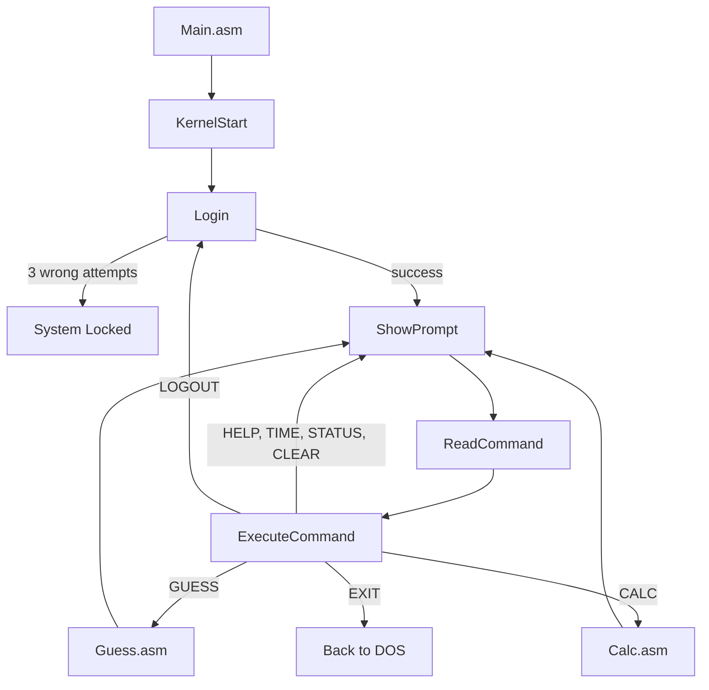

<h1 align="center">🖥️ OS Simulation</h1>

<p align="center">
  <b>A tiny command-line operating system written in pure x86 Assembly.</b><br>
  Login screen · Command prompt · Number-guessing game · Calculator
</p>

<p align="center">
  
  
  
  
  
</p>

---

## 📑 Table of Contents

- [Preview](#-preview)
- [Features](#-features)
- [Commands](#-commands)
- [Calculator](#-calculator)
- [Guess The Number](#-guess-the-number)
- [How It Works](#-how-it-works)
- [Project Structure](#-project-structure)
- [Build and Run](#-build-and-run)
- [Adding a New Command](#-adding-a-new-command)
- [Author](#-author)

---

## 👀 Preview

```text
======================================================
                 OS SIMULATION v1.1
======================================================
             Welcome to OS Simulation!

Username : Admin
Password : ****

==============================
HELP
CALC
TIME
LOGOUT
STATUS
CLEAR
EXIT
==============================

OSS> _
```

---

## ✨ Features

| | Feature | Details |
|---|---|---|
| 🔐 | **Login system** | Password masking with `*`, locks after 3 wrong attempts |
| ⌨️ | **Command prompt** | `OSS>` prompt with case-insensitive commands |
| 🎮 | **Guess The Number** | Mini game with hints and limited tries |
| 🧮 | **Calculator** | Add, subtract, multiply, divide with negative numbers support |
| 🧩 | **Modular code** | Each part lives in its own file and shares code with `PUBLIC` / `EXTRN` |

---

## 📟 Commands

| Command | What it does |
|:--|:--|
| `HELP` | Show the help menu |
| `GUESS` | Play the number guessing game |
| `CALC` | Open the calculator |
| `TIME` | Display the current time (`HH:MM:SS`) |
| `STATUS` | Show login status and attempts used |
| `CLEAR` | Clear the screen |
| `LOGOUT` | Log out and return to the login screen |
| `EXIT` | Exit the system |

> 🔑 **Default login:** `Admin` / `1234` (case-sensitive)

---

## 🧮 Calculator

Type `CALC` at the prompt. The calculator does **one operation**, waits for a key press, then returns to the system screen.

```text
================================
       Welcome To Calculator
================================

1. Addition
2. Subtraction
3. Multiplication
4. Division
5. Exit

Choose an operation: 1

Enter first number: 3

Enter second number: 4

Result: 7

Press any key to go back...
```

| Detail | Value |
|:--|:--|
| Input range | `-9999` to `9999` |
| Result size | 32-bit signed, so `9999 × 9999 = 99980001` works |
| Division | Integer quotient only |
| Errors handled | Invalid number, invalid choice, division by zero |

---

## 🎮 Guess The Number

Type `GUESS`. The system picks a number from **1 to 100** and you get **4 tries**.
After every guess you receive a `Too LOW` or `Too HIGH` hint. Type `Q` to quit.

---

## ⚙️ How It Works



### Shared routines

| Routine | Defined in | Description |
|:--|:--|:--|
| `PrintString` | `Kernel.asm` | Print a `$`-terminated string |
| `PrintChar` | `Kernel.asm` | Print the character in `DL` |
| `PrintNewLine` | `Kernel.asm` | Print CR + LF |
| `ClearScrean` | `Kernel.asm` | Clear the screen and reset the cursor |
| `ReadInput` | `Auth.asm` | Read a line. `BX` = buffer, `CX` = max length, `DH=1` shows stars |
| `CompareString` | `Command.asm` | Compare two strings. `CL=1` for case-sensitive |
| `ReloadScreen` | `Command.asm` | Clear the screen, then show the welcome message and commands |

---

## 📁 Project Structure

```text
📦 OS-Simulation
 ┣ 📜 Main.asm      → Entry point + shared data
 ┣ 📜 Kernel.asm    → Main loop + print / clear routines
 ┣ 📜 Auth.asm      → Login, logout, ReadInput
 ┣ 📜 Command.asm   → Command parser + executor
 ┣ 📜 Guess.asm     → Guessing game
 ┣ 📜 Calc.asm      → Calculator
 ┗ 📜 DEFINE.INC    → Shared constants
```

---

## 🚀 Build and Run

> **Requirements:** Turbo Assembler (TASM), Turbo Link (TLINK), and DOS (DOSBox or GUI Turbo Assembler).

**1️⃣ Assemble every source file** (`DEFINE.INC` is included automatically)

```bash
tasm Main.asm
tasm Kernel.asm
tasm Command.asm
tasm Auth.asm
tasm Guess.asm
tasm Calc.asm
```

**2️⃣ Link everything into one executable** (`Main` must come first)

```bash
tlink Main+Kernel+Command+Auth+Guess+Calc
```

**3️⃣ Run**

```bash
Main
```

> 💡 After changing a single file, re-assemble only that file and run `tlink` again.

---

## ➕ Adding a New Command

<details>
<summary><b>Click to see the steps</b></summary>

<br>

1. In `Command.asm`, add a string in `.data`:
   ```asm
   cmdMyCmd DB 'MYCMD$'
   ```
2. In the `.code` section, declare your procedure:
   ```asm
   EXTRN MyProc:Near
   ```
3. In `ExecuteCommand`, add a compare block (copy any existing one) that jumps to `MyCmdCommand`.
4. Add the label:
   ```asm
   MyCmdCommand:
       Call MyProc
       JMP Finish
   ```
5. Make `MyProc` `PUBLIC` in its own file and add that file to the `tlink` line.
6. Add the command name to `helpMsg` and `commandsString`.

</details>

---

## 👤 Author

**Ahmed Mandour**

[](https://github.com/AhmedMandour12)

**MOAZ Abdulsalam**
[](https://github.com/MoazAbdulsalam)
